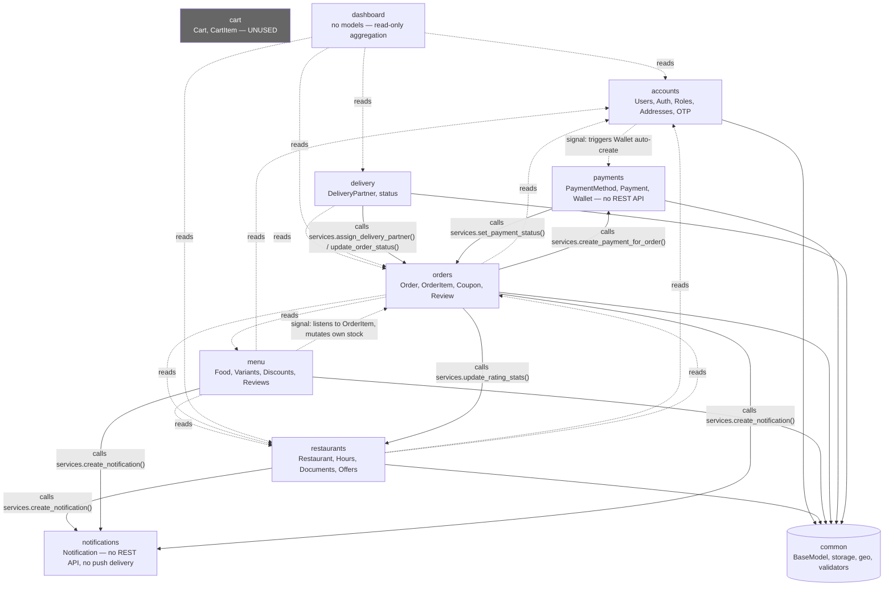
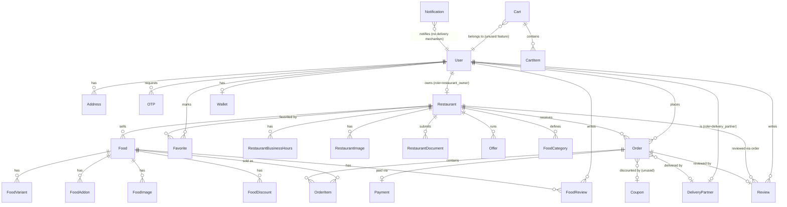
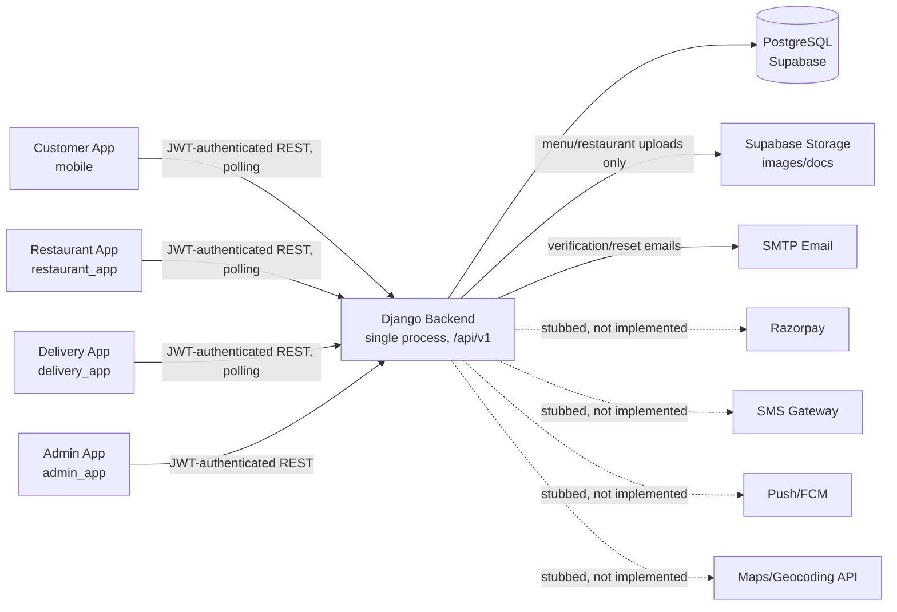

# Garuda Food Delivery Platform — Architecture Audit

**Audit date:** 2026-08-30
**Scope:** `Food-App/backend` (Django API) + `Food-App/mobile`, `restaurant_app`, `delivery_app`, `admin_app` (4 independent Flutter apps)
**Method:** Full read of models, views, serializers, signals, services, settings, migrations, pubspec files, and app source for all 9 backend domain apps and all 4 mobile apps. No files were modified as part of this audit.

Every claim below is tagged **[Verified]** (read directly in code, file path cited) or **[Inference]** (reasonable conclusion not directly stated in code). Nothing is invented. See §19 for what could not be determined at all.

---

## 1. Executive Summary

The system is a **modular monolith backend** (single Django project, single Postgres database, 9 domain-named apps) serving **4 independent Flutter client apps** (customer, restaurant, delivery partner, admin) that share no code beyond a copy-pasted core layer.

- **Backend**: Django 5.0.6 + DRF, one deployable process, one database (Supabase-hosted Postgres). Business logic is split into domain apps (`accounts`, `restaurants`, `menu`, `cart`, `orders`, `payments`, `delivery`, `notifications`, `dashboard`). As of 2026-08-30, every case where one app *created or mutated* another app's model directly now goes through a small `services.py` function owned by that app instead (see §5, "Public module interfaces"); read-only cross-app queries are still direct ORM reads by design. No formal repository layer exists — that's a separate, unaddressed gap from the backend README's description.
- **Mobile**: 4 Flutter apps, each independently scaffolded with Riverpod + go_router + dio, feature-based folder structure. No shared Dart package exists — the entire networking/auth/error-handling core is duplicated byte-for-byte across all 4 apps.
- **Database**: One Postgres instance, one schema, no read replicas, no sharding, no per-domain databases.
- **Deployment**: No Dockerfile, docker-compose, CI/CD, Procfile, or infra-as-code exists anywhere in the repository. `gunicorn` is a listed prod dependency, implying a WSGI deployment target, but the actual hosting setup is undocumented in-repo.
- **Main modules**: Auth/Users, Restaurants, Menu, Cart (present but unused), Orders, Payments (schema-only stub), Delivery, Notifications (DB sink, no delivery mechanism), Dashboard (admin aggregation).
- **Scaling**: The backend is close to stateless (JWT auth, no server-side sessions used for API auth) and could run multiple instances behind a load balancer, but there is no background job system, no cache layer, no WebSocket/realtime channel, and several features (payments, push notifications, GPS tracking) are schema-only stubs with no working implementation.
- **Biggest architectural risk**: several core domain features are incomplete or dead code — Cart is modeled but never read by the order flow, Payments has no gateway integration or API surface at all, Notifications never actually delivers anything to a device, and delivery-partner GPS coordinates are stored in the schema but never written by any code path. A reader of the data model alone would believe these features work; they do not.
- **Recommended next architectural step**: before any structural change (splitting services, adding Kubernetes, etc.), close the gap between the data model and the actual feature set — either implement or remove Cart, Payments, Notifications delivery, and GPS tracking — and add test coverage to `orders` (the core transactional path, currently untested). The monolith itself is not the bottleneck today.

---

## 2. Architecture Style Classification

### Backend: **Modular Monolith** (with weak module boundaries)

**[Verified]** facts used to classify:

| Question | Finding |
|---|---|
| One deployable backend? | Yes — single `manage.py`, one `config/settings/{base,dev,staging,prod}.py` tree, one `wsgi.py`/`asgi.py`. All 9 domain apps mount under one `/api/v1/` prefix in one `config/urls.py`. |
| Separate databases per module? | No — one `DATABASES["default"]` pointing at one Supabase Postgres instance (`config/settings/base.py`), shared by every app. |
| Separate processes/services? | No — no Dockerfile, no docker-compose, no per-app deployment unit. Everything runs in one Python process. |
| Independent deployment possible today? | No — apps are Python packages imported into one Django project; deploying `orders` without `accounts`/`menu`/`restaurants` would require extracting shared models and rewriting cross-app imports as network calls. |
| Independent scaling possible today? | No — the process/database boundary is the same for all modules; you scale the whole backend or none of it. |
| Do modules have clear boundaries? | **Partially.** Apps are cleanly separated by directory and each owns its own models/migrations. But: |
| Do modules directly access each other's internals? | **As of the original audit (2026-08-30, pre-refactor): yes, extensively**, including several cases of one app *writing* to another app's model. `menu/views.py` imports `apps.restaurants.models`/`permissions` (read-only, unchanged); `orders/services.py` imports `apps.accounts.models`, `apps.menu.models/services`, `apps.restaurants.models` (reads, unchanged) and previously imported `apps.payments.models` to write a `Payment` row directly (now calls `payments.services.create_payment_for_order()` — see §5); `delivery/views.py` imports `apps.orders.models`/`serializers` for its own reads (unchanged), while `delivery/services.py` previously wrote `Order.status`/`delivery_partner` directly (now calls `orders.services.assign_delivery_partner()`/`update_order_status()`); `dashboard/views.py` reads 4 apps' models directly for read-only stats (unchanged, intentional). **Net effect of the follow-up refactor: cross-app reads remain direct (by design); cross-app writes now go through the owning app's `services.py`.** |
| Do modules communicate through interfaces/services? | **Partially, as of the follow-up refactor.** The backend README claims a `models → repositories → services → serializers → views` layering — **no `repositories.py` file exists anywhere**, so that formal layer was never built. However, every concrete case of one app creating/mutating another app's data now goes through a small function in the owning app's `services.py` (§5's "Public module interfaces" table) rather than a direct model write. Signal handlers that only mutate their *own* app's models in reaction to another app's event (e.g. `menu/signals.py` listening to `"orders.OrderItem"` by string reference to decrement its own stock) are the correct domain-event pattern and were left unchanged. |

**Conclusion**: this is a **modular monolith by directory structure and domain naming**, but the module boundaries are **not enforced** — apps reach into each other's models, services, and permissions freely. It is closer to "one Django project organized by domain folders" than a monolith with genuinely decoupled internal modules. This matters because it means the boundaries visible in the folder structure would need real work (introducing service interfaces, removing direct cross-app ORM imports) before any module could be extracted as an independent service.

### Mobile: 4 independent single-purpose apps, not a single "mobile architecture"

Each of `mobile`, `restaurant_app`, `delivery_app`, `admin_app` is its own Flutter project with its own `pubspec.yaml`, own build targets, and no shared package dependency between them (**[Verified]** — no `packages/` or `shared/` directory anywhere in the repo, no `path:` dependency in any pubspec). They follow an identical convention by having been scaffolded from the same template, but there is no code-level sharing — see §3.

### Database: Single shared relational database, no architecture beyond that

One Postgres instance, one schema, all 9 apps' tables live in it. No CQRS, no per-domain database, no read replica configuration visible in settings.

### Deployment: **Undetermined / not present in repository**

No deployment manifests of any kind exist. See §12.

---

## 3. Mobile Application Architecture

> **Update:** a follow-up session (2026-08-30) explicitly requested converting the mobile apps to a feature-based modular architecture (`core/`, `auth/`, `restaurants/`, `menu/`, `cart/`, `orders/`, `profile/`, etc. per app). Re-verified against the current code: **no mobile files were changed**, because all 4 apps already use `lib/features/<name>/{data,domain,presentation}` with a `lib/core/` limited to genuinely shared infra (network/storage/error/theme/router/widgets/constants). A repo-wide grep found **zero cross-feature imports** (no feature imports another feature's code) in any of the 4 apps; the only `core → features` imports are route registration inside `app_router.dart`/`main_shell.dart` (each app's composition root necessarily knows about its screens to wire routes) — normal composition-root wiring, not business logic leaking into `core`. The target architecture requested for mobile was already met; see §5's "Public module interfaces" for where the real boundary work landed (the backend).

### 3.1 What's identical across all 4 apps **[Verified]**

- **State management**: Riverpod exclusively — `Notifier`, `FamilyNotifier`, `AsyncNotifier` classes throughout (e.g. `mobile/lib/features/auth/presentation/providers/auth_provider.dart`, `restaurant_app/lib/features/orders/presentation/providers/order_list_provider.dart`, `delivery_app/lib/features/orders/presentation/providers/available_orders_provider.dart`). A repo-wide grep found zero uses of `ChangeNotifier` (outside a router-refresh bridge), `Bloc`/`Cubit`, or GetX controllers. `setState` appears only a handful of times per app (5–9), always for local widget-only state (dropdowns, loading flags), never for app/domain state.
- **Dependency injection**: none of the 4 apps use `get_it`/`injectable`. Riverpod's `ProviderScope` (wired in each app's `main.dart`) acts as the de facto composition root/DI container.
- **Navigation**: `go_router` in all 4 apps, using `StatefulShellRoute.indexedStack` for a bottom-tab shell (Home/Orders/Cart/Profile in `mobile`; Orders/Menu/Settings in `restaurant_app`; Available/My Deliveries/Profile in `delivery_app`; Dashboard/Restaurants/Users/Delivery Partners/Orders in `admin_app`). `restaurant_app` and `delivery_app` add a **profile-completeness redirect gate** (`RestaurantSetupScreen`, `PartnerSetupScreen`) on top of the auth gate before granting access to the main shell; `admin_app`'s router comment notes role verification already happened server-side at login, so it only gates on auth state.
- **Networking**: `dio` wrapped by a `DioClient` (`lib/core/network/dio_client.dart`) plus an `AuthInterceptor` (`lib/core/network/auth_interceptor.dart`) — **byte-identical file in all 4 apps**. The interceptor attaches `Authorization: Bearer <token>` to every request and, on a 401, performs a **shared single-flight token refresh** (a `Completer` de-duplicates concurrent 401s into one refresh call) before retrying the original request once. On refresh failure, storage is cleared and a session-expired signal fires.
- **Token storage**: `flutter_secure_storage`, wrapped by `SecureStorageService` (`lib/core/storage/secure_storage_service.dart`) — also byte-identical across all 4 apps. Stores access token, refresh token, and a cached user JSON blob.
- **Error handling**: a consistent `AppException` hierarchy (`NetworkException`, `TimeoutAppException`, `UnauthorizedException`, `ValidationException`, `ServerException`, `UnknownException` in `lib/core/error/app_exception.dart`) produced from Dio exceptions, mapped by repositories into a UI-facing `Failure` type (`lib/core/error/failure.dart`) — identical files in all 4 apps.
- **Image display**: `cached_network_image` + `shimmer` placeholder wrapped in a shared `AppNetworkImage` widget (`lib/core/widgets/app_network_image.dart`) — identical across apps.
- **Folder organization**: feature-based (`lib/features/<feature>/{data,domain,presentation}`) plus a shared `lib/core/{constants,error,network,providers,router,storage,theme,utils,widgets}`. Layering rigor varies — `mobile` most consistently has a `domain/` layer with repository interfaces (e.g. `auth_repository.dart` + `auth_repository_impl.dart`); `restaurant_app`'s `menu`/`orders` features skip the `domain/` folder and go straight from `data/` to `presentation/`.
- **Testing**: all 4 apps ship only the default Flutter-scaffold placeholder `test/widget_test.dart` (a trivial `expect(1+1,2)`-style check). **No real unit or widget tests exist in any of the 4 apps.**
- **Offline support**: none. No Hive/sqflite/Isar in any pubspec. `connectivity_plus` (only in `mobile`) detects connectivity but does not enable a local cache — every screen live-fetches from the API.
- **Push notifications**: not implemented anywhere. No `firebase_messaging`/`onesignal` package in any pubspec, no `google-services.json`, no `firebase_options.dart` anywhere in the repository.
- **Image upload**: not implemented anywhere. No `image_picker` in any pubspec; `restaurant_app`'s "add dish" form (`add_food_screen.dart`) has no image field despite the backend's `Food`/`FoodImage` models supporting photos.

Architecturally, all 4 apps are best described as **feature-based, loosely layered, with an approximation of Clean Architecture** (repository interfaces + data/presentation split) that is applied inconsistently and whose "domain" layer is thin — mostly interfaces and models, no explicit use-case classes.

### 3.2 Per-app specifics **[Verified]**

**`mobile` (customer app, package `foodapp_customer`)**
- Auth: phone + OTP flow (`phone_entry_screen.dart` → `otp_verify_screen.dart`).
- Order tracking: **polling**, not push/WebSocket — `OrderDetailNotifier` re-fetches every 15s (`AppConstants.orderPollInterval`) while the order is in an active status, then stops.
- No location/maps package, no image picker.

**`restaurant_app` (`garuda_partner`)**
- Auth: email + password (`login_screen.dart`).
- Order list: polling every 20s (`Timer.periodic` in `order_list_provider.dart`) to surface new orders/cancellations without manual refresh.
- Onboarding gate: `RestaurantSetupScreen`/`BusinessHoursScreen` required before the main shell is reachable.
- No image upload capability despite the backend supporting menu-item photos.

**`delivery_app` (`garuda_delivery`)**
- Auth: email + password.
- **No GPS/location tracking implemented**: no `geolocator`/`location` package in `pubspec.yaml`, no location permission declared in `AndroidManifest.xml`, and the code says so explicitly — a comment in `delivery_order_remote_datasource.dart` on `getAvailableOrders()` states the job list is *"Not filtered by proximity — no live location yet."* This matches the backend, where `DeliveryPartner.current_latitude/current_longitude` exist in the schema but are never written by any code path (§6, §9).
- Available-orders job board polls every 15s, **but only while the partner's `isOnline` flag is true** — avoids polling for offline drivers.
- Onboarding gate: `PartnerSetupScreen` required before the main shell.

**`admin_app` (`garuda_admin`)**
- Simplest app: 5-tab shell (Dashboard/Restaurants/Users/Delivery Partners/Orders), lowest `setState` usage, no observed active polling in this pass (dashboard/CRUD screens appear to be fetch-on-navigation) — **[weaker confidence: individual dashboard provider files were grepped but not all read line-by-line]**.
- Auth gate only checks authentication state; role correctness is asserted to have already been enforced server-side during login.

### 3.3 Cross-app comparison

| Aspect | mobile | restaurant_app | delivery_app | admin_app |
|---|---|---|---|---|
| Auth method | Phone + OTP | Email + password | Email + password | Email + password |
| Realtime mechanism | Polling (15s, order detail) | Polling (20s, order list) | Polling (15s, job board, online-only) | Fetch-on-navigation (not confirmed polling) |
| Onboarding gate | None beyond auth | Restaurant profile setup | Partner profile setup | None beyond auth |
| GPS/location | N/A | N/A | **Not implemented** | N/A |
| Image upload | N/A (display only) | Not implemented (missing from add-dish form) | N/A | N/A |
| Shared code with siblings | `core/` files byte-identical but copy-pasted, not a shared package | same | same | same |

**Maintenance risk** (see §17): because `core/network`, `core/storage`, and `core/error` are literally duplicated per app rather than factored into a shared Dart package, a bug fix or endpoint contract change (e.g. token refresh logic, error mapping) must be applied by hand in 4 places.

---

## 4. Backend Architecture

### 4.1 Stack **[Verified]**

- **Framework**: Django 5.0.6 + Django REST Framework 3.15.2 (`requirements/base.txt`)
- **Language**: Python (running on Python 3.14 in practice — see §17 for the version-mismatch risk this creates)
- **Auth**: `djangorestframework-simplejwt` 5.3.1
- **API docs**: `drf-spectacular` (OpenAPI schema, Swagger UI, Redoc at `/api/schema/`, `/api/docs/`, `/api/redoc/`)
- **Entry points**: `manage.py`, `config/wsgi.py` / `config/asgi.py` (both default `DJANGO_SETTINGS_MODULE` to `config.settings.prod`)
- **Database**: PostgreSQL via `psycopg2-binary`, connection string from `DATABASE_URL` env var (Supabase-hosted, SSL required by default)

### 4.2 How a request travels through the backend **[Verified]**

There are **no ViewSets and no repository layer** anywhere in the codebase — every endpoint is a plain DRF `APIView` (or a SimpleJWT stock view for token endpoints). The actual flow is:

```text
Mobile/Web Client
    ↓  HTTPS request with Authorization: Bearer <JWT>
DRF APIView (apps/<domain>/views.py)
    ↓  permission_classes check (apps.accounts.permissions.{IsCustomer,IsRestaurantOwner,IsDeliveryPartner,IsAdminRole,...})
    ↓  Serializer validates/deserializes request body (apps/<domain>/serializers.py)
Service function (apps/<domain>/services.py) — business logic, often wrapped in @transaction.atomic
    ↓  reads/writes via Django ORM — frequently importing OTHER apps' models directly here
PostgreSQL (single shared database)
    ↓
Django signal handlers (apps/<domain>/signals.py) fire on model save/delete
    ↓  often reach into OTHER apps' models directly (e.g. create a Notification row, recompute a rating, sync a status)
Response serialized back through apps.common.response.APIResponse / apps.common.pagination
    ↓
Uniform envelope: {"success": true/false, "data"/"error": {...}}
```

The README's claimed `models → repositories → services → serializers → views` layering is **[Inference: aspirational, not implemented]** — grep confirms no `repositories.py` exists in any app.

### 4.3 Cross-cutting infrastructure (`apps/common`) **[Verified]**

- `BaseModel` (`apps/common/models.py`) — UUID primary keys, `created_at`/`updated_at`, and soft-delete (`SoftDeleteQuerySet`/`SoftDeleteManager`/`AllObjectsManager`) — inherited by **every domain model in the project**.
- `apps.common.exceptions.custom_exception_handler` — wired via `REST_FRAMEWORK["EXCEPTION_HANDLER"]` — produces the uniform error envelope.
- `apps.common.response.APIResponse` / `apps.common.pagination.StandardResultsSetPagination` (page size 20, max 100) — used by nearly every list endpoint.
- `apps.common.validators` — shared field validators (phone E.164, pincode, coupon code, vehicle/license number, lat/lng, rating, percentage).
- `apps.common.geo.haversine_distance_km()` — plain-Python great-circle distance calculation. **No PostGIS, no external geocoding/maps API is used anywhere in the backend.**
- `apps.common.storage.SupabaseStorageService` — a hand-rolled `requests`-based wrapper calling the Supabase Storage REST API directly for image/document uploads (used by `menu` and `restaurants`). Notably, **this is not wired as Django's default file storage** — `STORAGES["default"]` in settings is still local `FileSystemStorage`; Supabase upload is only invoked explicitly by those two apps' upload services, not globally.
- `apps/common/apps.py` contains a runtime monkeypatch working around a Django 5.0 / Python 3.14 incompatibility in `BaseContext.__copy__` that otherwise breaks the Django admin — direct evidence the project runs on a Python version ahead of Django 5.0's officially supported range.

---

## 5. Food-Delivery Domain Modules

### Dependency diagram (only edges confirmed by actual cross-app imports/signals)



Solid labeled arrows are calls into the target app's own `services.py` — the public-interface pattern introduced in this session (see "Public module interfaces" below) for every case where one app previously created or mutated another app's model directly. Dashed `.reads.` arrows are read-only cross-app ORM queries (FK lookups, filters, aggregates) — left as direct reads by design; wrapping trivial reads in a service call was judged unnecessary abstraction. The `menu`↔`orders` signal (menu reacting to a new `OrderItem` to decrement its own stock) and the `accounts`→`payments` signal (auto-creating a `Wallet` row) are unchanged — both are the correct "domain event, own-model mutation only" pattern and were never boundary violations.

### Public module interfaces

Introduced to replace direct cross-app model mutation (previously `from <app>.models import X` followed by `X.objects.create(...)` or a direct field write from outside the owning app). Each is intentionally small — one function per concrete cross-app write that existed, not a generic framework:

| Function | Owning app | Called by | Replaces |
|---|---|---|---|
| `notifications.services.create_notification(*, user_id, notification_type, title, body, order_id=None)` | `notifications` | `orders.signals`, `restaurants.signals`, `menu.signals` | Each signal handler calling `Notification.objects.create(...)` directly |
| `payments.services.create_payment_for_order(order, *, method, amount)` | `payments` | `orders.services.place_order` | `orders.services` calling `Payment.objects.create(...)` directly |
| `restaurants.services.update_rating_stats(restaurant_id, *, average_rating, total_reviews)` | `restaurants` | `orders.signals._recompute_restaurant_rating` | `orders.signals` writing `Restaurant.average_rating`/`total_reviews` via a direct queryset `.update()` |
| `orders.services.assign_delivery_partner(order, delivery_partner)` | `orders` | `delivery.services.accept_order` | `delivery.services` setting `order.delivery_partner`/`order.status` directly |
| `orders.services.update_order_status(order, new_status)` (existing, now also used by delivery) | `orders` | `delivery.services.mark_delivered` | `delivery.services` setting `order.status`/`order.delivered_at` directly (required adding `OrderStatus.OUT_FOR_DELIVERY: {OrderStatus.DELIVERED}` to `ALLOWED_STATUS_TRANSITIONS`, which was previously missing) |
| `orders.services.set_payment_status(order_id, new_payment_status)` | `orders` | `payments.signals.sync_order_payment_status` | `payments.signals` calling `Order.objects.filter(...).update(payment_status=...)` directly. Deliberately kept as a queryset `.update()` (not fetch+`.save()`) to preserve the pre-existing behavior that this path does not fire `Order`'s `post_save` signals |

All six are covered by new tests: `apps/notifications/tests/test_services.py`, `apps/payments/tests/test_services.py`, `apps/delivery/tests/test_services.py` (all three apps had zero tests before this session), plus additions to `apps/orders/tests/test_services.py` (new file — `orders` also had zero tests before) and `apps/restaurants/tests/test_restaurant_rating.py`.

Left as direct reads (not wrapped in an interface — see rationale above): `menu.views` reading `restaurants.models.Restaurant`, `restaurants.services.get_rating_breakdown` reading `orders.models.Review`, and `dashboard.views.DashboardStatsView` reading models from `accounts`/`restaurants`/`orders`/`delivery` for its read-only stats aggregation.

### Per-module detail **[Verified unless noted]**

| Module | Responsibility | Owns its data? | Other apps reach in directly? | Status |
|---|---|---|---|---|
| **accounts** | User model (custom, `phone_number` as `USERNAME_FIELD`), single `role` field (customer/restaurant_owner/delivery_partner/admin — one table, not per-role profile rows), Address, OTP, JWT issuance, role-based permission classes reused project-wide | Yes | Yes — nearly every app imports `apps.accounts.models`/`permissions` | Fully implemented, well tested (7 test files) |
| **restaurants** | Restaurant profile + approval workflow, business hours, images, compliance documents, favorites, offers | Yes | `menu`, `dashboard` read its models directly (fine — reads); `orders` now writes rating fields only via `restaurants.services.update_rating_stats()` | Fully implemented, well tested (9 files) |
| **menu** | Food items, variants, addons, GST-based pricing pipeline, discounts, reviews, stock | Yes | Imports `restaurants`/`accounts` directly (reads); listens to `orders.OrderItem` via signal to decrement stock — **inventory management for orders actually lives here, not in `orders`** | Fully implemented, well tested (8 files) |
| **cart** | Cart/CartItem models with single-restaurant-per-cart enforcement | Model exists, but **`urls.py` is an empty list — no views or serializers exist**. `orders.services.place_order()` takes line items straight from the request body, never reads a `Cart` row. | No other app reads it either | **Modeled but functionally dead/unused — out of scope for the module-boundary refactor** (no cross-app coupling to fix; implementing or removing it is a product decision) |
| **orders** | Order placement (atomic transaction), status state machine (`placed→accepted→preparing→ready_for_pickup→out_for_delivery→delivered/cancelled`), price snapshotting on `OrderItem`, `Review` model, delivery-partner assignment, payment-status sync | Yes | Reads `accounts`/`menu`/`restaurants` directly; now calls `payments.services.create_payment_for_order()` instead of creating `Payment` directly. Exposes `assign_delivery_partner()`/`update_order_status()`/`set_payment_status()` for `delivery`/`payments` to call instead of writing `Order` fields themselves. | Core flow implemented; `Coupon` model exists but is **never applied** (discount hardcoded to 0.00); delivery fee hardcoded to ₹30; `Review` model has **no create/list API** despite a rating-recompute signal existing for it; had zero test files — now has `apps/orders/tests/test_services.py` covering the service-layer functions (still no API/view-level tests) |
| **payments** | PaymentMethod, Payment (Razorpay fields), Wallet (atomic credit/debit) | Yes | Exposes `payments.services.create_payment_for_order()` for `orders` to call; calls `orders.services.set_payment_status()` instead of writing `Order.payment_status` directly | **No `views.py`, no `serializers.py`, `urls.py` is still empty — no client-facing REST API.** No Razorpay SDK in requirements, no webhook, no signature verification anywhere. Wallet auto-created via signal on user creation. **Still a stub from a client's perspective; now has an internal service interface for the backend's own order-placement flow.** Had zero tests — now has `apps/payments/tests/test_services.py`. |
| **delivery** | Delivery partner profile, online/offline status, accept/deliver order actions | Yes | Reads `orders.models`/`serializers` for its own queries; calls `orders.services.assign_delivery_partner()`/`update_order_status()` instead of writing `Order` fields directly | Accept/deliver flow implemented; `current_latitude`/`current_longitude`/`last_location_update_at` fields exist on `DeliveryPartner` but **are never written by any view or service** — GPS tracking is schema-only, matching the mobile app's confirmed absence of location code. Had zero tests — now has `apps/delivery/tests/test_services.py`. |
| **notifications** | Stores `Notification` rows (type, title, body, read state, `fcm_response` JSON field) | Yes | Exposes `notifications.services.create_notification()`, called by `orders`/`restaurants`/`menu` signals instead of each creating `Notification` rows directly. **Still no `views.py`/`serializers.py`/`urls.py` content of its own** — no client-facing API. | **No API to list/mark-as-read notifications, and no push-delivery code anywhere** — `fcm_response` is written by nothing. DB records only; nothing reaches a device. Had zero tests — now has `apps/notifications/tests/test_services.py`. |
| **dashboard** | Admin-only stats aggregation | No models | Directly queries ORM models from `accounts`, `delivery`, `orders`, `restaurants` in one view (`DashboardStatsView`) | Implemented but bypasses any service boundary — the clearest example of cross-cutting coupling in the codebase |

---

## 6. Database Architecture

**Technology**: PostgreSQL (Supabase-hosted), accessed via Django ORM + `psycopg2-binary`. **[Verified]** No caching layer (no Redis, no `CACHES` setting). No read/write splitting, no sharding, no PostGIS extension use despite location fields existing.

### Entity diagram (major entities and verified relationships only)



- **Foreign keys of note**: `Order.delivery_partner` → `apps.delivery.DeliveryPartner`; `Order.coupon` → `apps.orders.Coupon` (set nowhere); `OrderItem` snapshots food/variant name and price at order time (correct pattern — protects historical orders from later price changes); `Payment` is OneToOne with `Order`; `Wallet` is OneToOne with `User`.
- **Soft delete**: every model inheriting `apps.common.models.BaseModel` supports soft delete via `SoftDeleteManager`/`AllObjectsManager` — this is the default across the whole schema, not a per-model opt-in.
- **UUID primary keys** throughout (via `BaseModel`), not auto-incrementing integers.
- **Migrations**: small and linear per app (1–2 migrations each, no data migrations), consistent with a young, evolving schema rather than one that has undergone significant iteration.
- **Transactions**: `orders.services.place_order()` wraps order + order-items + payment-row creation in one `@transaction.atomic` block — the one clearly transactional write path identified in the codebase.
- **Indexes**: not separately audited beyond what Django/DRF create by default (PK/FK indexes); no explicit custom index definitions were found in the models read.

---

## 7. API Architecture

All endpoints are mounted under `/api/v1/` (`config/urls.py`), grouped by domain:

```text
/api/v1/auth/          — apps.accounts.urls
/api/v1/restaurants/   — apps.restaurants.urls
/api/v1/menu/          — apps.menu.urls  (nested under restaurants/<id>/foods/...)
/api/v1/cart/          — apps.cart.urls        (EMPTY — no endpoints)
/api/v1/orders/        — apps.orders.urls
/api/v1/payments/      — apps.payments.urls    (EMPTY — no endpoints)
/api/v1/delivery/      — apps.delivery.urls
/api/v1/notifications/ — apps.notifications.urls (EMPTY — no endpoints)
/api/v1/dashboard/     — apps.dashboard.urls
```

Plus `/admin/` (Django admin), `/health/` (health check), `/api/schema/`, `/api/docs/`, `/api/redoc/` (drf-spectacular).

### Domain endpoint summary **[Verified]**

- **auth**: `register/`, `login/` (email+password), `otp/request|verify` (phone OTP, auto-provisions account), `token/refresh|verify`, `logout/` (blacklists refresh token), `me/`, `password/forgot|confirm`, `email/verify/*`, `phone/verify/*`, `addresses/` CRUD, `admin/users/`. Mostly `AllowAny` for entry points, `IsAuthenticated` (+role checks) elsewhere. Rate-limited via `ScopedRateThrottle` on register/login/otp/password_reset.
- **restaurants**: public GET (list/detail/search — with Python-level cuisine/distance/open-now filtering layered on top of DB filtering), owner/admin-gated writes (create, business hours, images, documents), favorites, offers.
- **menu**: nested under a restaurant; owner-gated writes, public reads; pricing computed server-side via `menu.services.calculate_price()` (base price → active discount → GST → final).
- **cart**: no endpoints exist.
- **orders**: customer create/list/detail/cancel, restaurant-owner order list + status update (constrained by an explicit `ALLOWED_STATUS_TRANSITIONS` map), admin "all orders" view. No review-submission endpoint despite the `Review` model.
- **payments**: no endpoints exist.
- **delivery**: partner profile create/update, online/offline toggle, available-orders list (unfiltered by proximity), my-deliveries, accept/mark-delivered, admin partner list/verify.
- **notifications**: no endpoints exist — clients have no way to fetch or mark-read their notifications via this API.
- **dashboard**: one admin-only endpoint, `GET /dashboard/stats/`.

---

## 8. Authentication and Authorization

```text
Mobile App
    ↓  POST /auth/login/ (email+password)  OR  /auth/otp/request/ → /auth/otp/verify/ (phone+OTP)
Backend (apps/accounts)
    ↓  validates credentials / OTP code (hashed, expiring, attempt-limited)
    ↓  issues JWT pair via SimpleJWT — access token (30 min), refresh token (7 days, rotated + blacklisted on use)
Mobile App
    ↓  stores both tokens in flutter_secure_storage (SecureStorageService)
Authenticated API requests
    ↓  Authorization: Bearer <access token> attached by dio's AuthInterceptor
    ↓  on 401 → interceptor performs one shared refresh call, retries original request
```

- **Custom user model**: `apps.accounts.User` (`AbstractBaseUser` + `PermissionsMixin`), UUID PK, `USERNAME_FIELD = "phone_number"`.
- **Roles**: a single `role` field on `User` — `customer` / `restaurant_owner` / `delivery_partner` / `admin` — not separate per-role tables (though `Restaurant` and `DeliveryPartner` are separate profile models that FK back to a `User` of the matching role).
- **Two login flows**: email+password for restaurant owners/admins; phone+OTP for customers/delivery partners, which **silently auto-creates** a `User` on first OTP request if none exists.
- **Authorization**: a custom `HasRole` permission-class family in `apps.accounts.permissions` (`IsCustomer`, `IsRestaurantOwner`, `IsDeliveryPartner`, `IsAdminRole`, `IsEmailVerified`, `IsPhoneVerified`) — reused as the project's sole RBAC mechanism across every app.
- **SMS delivery of OTPs is a stub**: `apps.accounts.services.send_sms()` only logs the message — the code's own docstring states no SMS gateway (Twilio/MSG91/etc.) is wired in yet. In `DEBUG=True`, the OTP code is echoed back in the API response body for developer convenience — this must not reach a production build.
- **Token storage on mobile**: `flutter_secure_storage`, identical wrapper across all 4 apps.
- **No server-side session-based auth for the API** — auth is fully JWT/stateless from the API's perspective (Django's session middleware is present for the Django admin UI only).

---

## 9. Real-Time Architecture

**There is no real-time infrastructure in this system.** **[Verified]**

- `config/asgi.py` is 9 lines — just Django's default `get_asgi_application()`. No `channels` package, no `consumers.py`, no `routing.py` anywhere in the repository. `ASGI_APPLICATION` is set in settings but nothing beyond the stock ASGI app is wired up.
- All "live" updates observed are **client-side polling**, not server push:

```text
Mobile App (order detail screen)
    ↓  Timer fires every 15s while order.status.isActive
    ↓  GET /orders/<id>/
Backend
    ↓  reads current Order row
    ↓  returns latest status
Mobile App
    ↓  updates UI if status changed
```

Same pattern for `restaurant_app`'s incoming-order list (20s) and `delivery_app`'s available-orders job board (15s, only while the partner is online).

- **Driver location tracking does not exist end-to-end**: the backend schema has `DeliveryPartner.current_latitude`/`current_longitude`/`last_location_update_at`, but no endpoint or service writes them, and `delivery_app` has no location package or permission to read/send GPS coordinates in the first place. This is a fully unimplemented feature on both sides of the stack, not a partial implementation.
- No Redis, no message broker, no pub/sub of any kind exists to support real-time delivery even if a WebSocket layer were added later.

---

## 10. Background Jobs and Asynchronous Processing

**There are none. Everything runs synchronously inside the Django request/response cycle.** **[Verified]** — a repository-wide search for `celery`, `django_celery_beat`, `django-q`, `huey`, `apscheduler`, `@shared_task`, and `cron` across all Python files and all three `requirements/*.txt` files returned zero matches.

```text
Create Order (apps.orders.services.place_order)
    │
    ├── Validate items against live menu ───────── synchronous
    ├── Create Order + OrderItem rows (atomic) ──── synchronous
    ├── Create Payment row ──────────────────────── synchronous
    ├── Signal: decrement Food/FoodVariant stock ── synchronous (in-process signal, same transaction context)
    └── Signal: create Notification row ─────────── synchronous (DB write only — no actual delivery happens, sync or async)
```

Even things that would typically be offloaded (email sending, "SMS" OTP dispatch, notification creation) execute inline in the request. This keeps the system simple to reason about at current scale, but means a slow downstream call (e.g. a real SMS/email provider once integrated) would directly add to API response latency, and there is no retry/backoff mechanism for any of these operations today.

---

## 11. External Services

| Service | Status | Where | Data flow |
|---|---|---|---|
| **Payment gateway (Razorpay)** | **Stub only** — model fields for `razorpay_order_id`/`payment_id`/`signature` exist, no SDK in requirements, no webhook endpoint, no signature verification code | `apps/payments/models.py` | None today — nothing is actually sent to or received from Razorpay |
| **SMS (OTP delivery)** | **Stub** — logs the OTP instead of sending it | `apps/accounts/services.py` | None — OTP is only ever visible via logs or (in DEBUG) the API response |
| **Email** | **Real** — Django SMTP backend in staging/prod, console backend in dev | `config/settings/{base,dev}.py` | Outbound only (verification links, password reset) |
| **Push notifications (FCM)** | **Not implemented** — `Notification.fcm_response` field exists, nothing ever writes to it | `apps/notifications/models.py` | None |
| **Maps / geocoding** | **Not integrated** — distance is computed with a plain-Python haversine formula, no Google Maps/Mapbox API call anywhere | `apps/common/geo.py` | None (no external calls) |
| **Cloud file storage (Supabase Storage)** | **Real**, but narrowly wired — a custom `requests`-based client calls the Supabase Storage REST API directly for `menu`/`restaurants` image and document uploads. **Not** integrated as Django's global default file storage (`STORAGES["default"]` remains local `FileSystemStorage`). | `apps/common/storage.py` | Outbound: image/document bytes → Supabase; inbound: public URL stored on the model |
| **Database (Supabase Postgres)** | **Real**, primary data store for everything | `config/settings/base.py` (`DATABASE_URL`) | Bidirectional, continuous |
| **Redis / cache** | **Not present** — no `CACHES` setting, no `django-redis` | — | None |
| **Error monitoring (Sentry)** | **Installed but dead** — `sentry-sdk` is listed in `requirements/prod.txt` but `sentry_sdk.init(...)` is never called anywhere in the code | `requirements/prod.txt` | None currently — no crash telemetry actually leaves the server |

**Critical-path assessment**: of everything in this table, only the **database** and **Supabase Storage** (for the two apps that use it) are both real and load-bearing today. Payments, push notifications, maps, and monitoring are all either stubbed or dead — meaning the product cannot currently process real payments, cannot notify users off-device, cannot geo-rank restaurants/drivers using real map data, and has no visibility into production errors beyond log files.

---

## 12. Deployment and Infrastructure

**Deployment architecture could not be determined from the repository.** **[Verified absence]**

Searched the entire monorepo (`Food-App/` and its parent) for: `Dockerfile`, `docker-compose*`, `nginx.conf`, `Procfile`, `render.yaml`, `railway.json`, `fly.toml`, `runtime.txt`, and `.github/workflows/*` — **none exist**.

What can be inferred from dependencies alone **[Inference]**:
- `gunicorn==22.0.0` is a `prod`-only requirement → the backend is intended to run behind a WSGI server, not Django's dev server, in production.
- `whitenoise` serves static files directly from the Django process (`base.py`) → no separate static-file CDN/webserver is assumed to be configured, or whitenoise is a fallback until one is.
- Environment-specific behavior (`DEBUG`, `ALLOWED_HOSTS`, `CORS_ALLOWED_ORIGINS`, HSTS/SSL-redirect/secure-cookies) is controlled entirely through env vars layered on `config/settings/{dev,staging,prod}.py`, implying deployment relies on env-var injection from whatever host runs it (e.g. a PaaS), rather than baked-in config per environment.

What is **explicitly unknown**: which host/PaaS/VM this runs on, how the database is provisioned/backed up beyond "Supabase," whether there's a CDN in front of static/media assets, how secrets are managed, and whether there is more than one running backend instance today.

```text
[Cannot diagram — no infrastructure definition exists in the repository to draw from]
```

---

## 13. Scaling Architecture

| Question | Answer | Evidence |
|---|---|---|
| Is the backend stateless? | **Mostly** — API auth is JWT-based, no server-side session store is used for API requests (only Django admin uses sessions). | `SIMPLE_JWT` config, session middleware present but only exercised by `/admin/` |
| Does it depend on local filesystem state? | **Yes, partially** — `STORAGES["default"]` is local `FileSystemStorage`; any media path not explicitly routed through `SupabaseStorageService` would be written to local disk, which would not be shared across multiple instances. | `config/settings/base.py` |
| Shared Redis/DB state? | Only the database is shared; no Redis exists. | confirmed absence of `CACHES`/`django-redis` |
| Can multiple backend instances run simultaneously? | **[Inference] Likely yes for the JWT/API surface**, but the local-filesystem-storage gap above means any endpoint that saves files without going through `SupabaseStorageService` would behave inconsistently across instances. |
| Are WebSocket connections compatible with horizontal scaling? | N/A — there are no WebSocket connections to scale. |
| Does the architecture support independent module scaling? | **No** — one process, one database; scaling means running more copies of the whole backend, not scaling `orders` or `menu` independently. |
| Likely bottlenecks | (1) The single Postgres instance — every domain app hits the same DB with no read replica; (2) synchronous execution of all side effects (§10) — as soon as email/SMS/payment calls become real network calls, they will add directly to request latency and reduce throughput under load; (3) `restaurants.services.search_restaurants()` does DB filtering then **Python-level** cuisine/distance/open-now filtering — this will not scale well as the restaurant count grows, since filtering happens in application memory rather than the database. |

```text
Plausible near-term scaling (not yet built, but consistent with current code):

Load Balancer
     │
 ┌───┴────┐
 ▼        ▼
App #1   App #2      (stateless JWT API — feasible today for most endpoints)
 │        │
 └───┬────┘
     ▼
PostgreSQL (single instance — remains the shared bottleneck)
```

---

## 14. Architecture Classification

```text
Architecture:

Mobile:
  4 independent Flutter apps, each feature-based with a partial Clean-Architecture
  layering (Riverpod for state/DI, go_router for navigation, dio+interceptor for
  networking). No shared package — core layer is duplicated per app.

Backend:
  Modular Monolith with weak module boundaries — one deployable, one database,
  domain-named Django apps that import each other's models/services directly
  rather than through a service interface or repository layer.

Database:
  Single shared PostgreSQL instance (Supabase-hosted). No sharding, no read
  replicas, no per-domain database, no caching layer.

Deployment:
  Undetermined — no infrastructure-as-code, containerization, or CI/CD exists
  in the repository. gunicorn is present as a prod dependency, implying a WSGI
  deployment target, but the actual hosting setup is not documented in-repo.
```

### Why this classification — concrete evidence

1. One `manage.py`/`config/` tree serves all 9 domain apps under a single `/api/v1/` URLconf — one deployable, not several.
2. One `DATABASES["default"]` entry, shared by every app's models — not per-domain databases.
3. No `repositories.py` exists anywhere, despite the backend README describing that layer — the claimed architecture and the actual code diverge.
4. `orders/services.py`, `menu/views.py`, `delivery/views.py`, and `dashboard/views.py` all directly import models/services from sibling apps — module boundaries exist as folders, not as enforced interfaces.
5. Cross-app "events" are Django signal handlers reaching directly into other apps' models (including one keyed by a string model reference, `"orders.OrderItem"`) — not a message bus, not decoupled.
6. No Dockerfile/docker-compose/Kubernetes manifests/CI pipeline exist — nothing supports independent deployment of any single module today.
7. All 4 mobile apps hit the identical backend origin and endpoint set (verified from `api_constants.dart` in each) — one backend serving many clients, not several backend services.
8. No message broker, task queue, or WebSocket layer exists — real-time and async behavior are simulated via client-side polling, not backend infrastructure.
9. Payments, notifications-delivery, and GPS tracking are schema-complete but code-incomplete — meaning some "modules" in the folder structure are placeholders rather than working services, which further undercuts treating this as a mature multi-service system.
10. Test coverage is concentrated in 3 of 10 backend apps (`accounts`, `restaurants`, `menu`) and 0 of 4 mobile apps have real tests — consistent with an early-stage, single-team codebase rather than a mature, independently-owned set of services.

None of this changes with the 2026-08-30 follow-up refactor (see §5, "Public module interfaces") — it remains one deployable, one database, no microservices, by explicit design. What changed is narrower: items 4 and 5's *write* paths (module A creating/mutating module B's rows) now go through module B's own `services.py` function instead of a direct model import; the *read* paths in items 4 and the signal-based domain-event pattern in item 5 are unchanged and were not considered violations.

---

## 15. Architecture Diagrams

### System context



### Backend module diagram

See §5 for the full annotated dependency diagram with signal/import edges.

### Request lifecycle

See §4.2 — confirmed to match the actual code (`APIView → permission check → serializer → service function → ORM → signals → response envelope`); there is no controller/repository split beyond this.

### Database/domain diagram

See §6.

### Deployment diagram

Not available — see §12.

---

## 16. Architecture Strengths

1. **Consistent base model across the entire schema** — `BaseModel` (UUID PKs, timestamps, soft delete) is applied uniformly, avoiding the common problem of inconsistent primary-key/audit-field conventions across a growing schema.
2. **Correct order-time price snapshotting** — `OrderItem` stores food/variant name and price at order time rather than referencing live `Food` rows, protecting historical orders from later menu price changes.
3. **Atomic order placement** — `place_order()` wraps order/order-item/payment creation in a single `@transaction.atomic` block, avoiding partial-order data corruption.
4. **Uniform API response envelope and error handling** — `apps.common.response`/`apps.common.exceptions` give every endpoint the same `{"success", "data"/"error"}` shape, which is genuinely useful for client-side consistency, and is honored across all 9 apps.
5. **Reasonable role-based access control** — a single, consistently reused permission-class family (`apps.accounts.permissions`) is applied across every domain app rather than each app inventing its own auth checks.
6. **Simple, low-operational-complexity deployment shape** — one Django process, one database, no message broker, no container orchestration to operate. For a team of the apparent current size, this avoids a large class of distributed-systems operational burden.
7. **Environment-aware settings with real security hardening in prod** — `prod.py` correctly layers in HSTS, secure cookies, `X_FRAME_OPTIONS`, and SSL redirect that `dev.py` deliberately omits, and both staging/prod fail fast (`ImproperlyConfigured`) if `ALLOWED_HOSTS`/`CORS_ALLOWED_ORIGINS` are left empty — a good guardrail against accidental insecure production config.
8. **Consistent, testable mobile networking layer** — the `dio` + `AuthInterceptor` combination (even though duplicated across apps) correctly implements single-flight token refresh, which is a commonly-botched piece of client auth logic.
9. **Good test coverage where it exists** — `accounts`, `restaurants`, and `menu` (including a dedicated `test_pricing_gst.py` and `test_inventory.py`) have real, structured pytest suites with fixtures (`conftest.py`), showing the team knows how to write good tests when they do.

---

## 17. Architecture Weaknesses and Risks

```text
Issue: No repository/service-interface layer despite documented intent
Evidence: (Originally) apps/*/services.py and views.py imported sibling apps'
          models directly to CREATE/MUTATE their rows — orders.services.place_order
          called Payment.objects.create(...) directly; restaurants/menu/orders
          signals called Notification.objects.create(...) directly; orders.signals
          wrote Restaurant.average_rating/total_reviews directly;
          delivery.services.{accept_order,mark_delivered} wrote Order.status/
          delivery_partner directly; payments.signals wrote Order.payment_status
          directly. No repositories.py exists anywhere; backend README describes
          a layering that isn't implemented.
Status: PARTIALLY FIXED (this session). All six write-boundary violations above
        now go through a small function in the owning app's services.py instead:
        apps.notifications.services.create_notification,
        apps.payments.services.create_payment_for_order,
        apps.restaurants.services.update_rating_stats,
        apps.orders.services.{assign_delivery_partner,set_payment_status,update_order_status}.
        See "Public module interfaces" below §5. Read-only cross-app queries
        (e.g. menu/views.py reading Restaurant, restaurants.services.get_rating_breakdown
        reading orders.Review, dashboard.views reading 4 apps' models) were left
        as direct ORM reads by design — wrapping trivial reads in a service call
        was judged to be over-engineering with no boundary-protection benefit.
        No formal repositories.py layer was introduced — that remains a gap if the
        team wants one, but the concrete mutation-boundary violations are resolved.
Impact: The remaining exposure is smaller: extracting a module into a separate
        service still requires rewriting the *read* call sites as network calls,
        but no module can silently corrupt another module's owned data via a
        stray field write anymore — that path now always goes through a function
        the owning module controls.
Severity: Medium (downgraded from High)
```

```text
Issue: Payments module is a non-functional stub
Evidence: apps/payments has no views.py, no serializers.py, urls.py is empty;
          no Razorpay SDK in requirements; no webhook or signature-verification code.
Impact: The application cannot process a real payment today. Any UI implying
        payment happens is not backed by working server logic.
Severity: Critical
```

```text
Issue: Cart module is modeled but functionally dead
Evidence: apps/cart/urls.py is an empty list; orders.services.place_order() takes
          items directly from the request payload rather than reading a Cart row;
          no code anywhere reads or writes CartItem outside apps/cart itself.
Impact: Confusing for future developers who will assume Cart is the real
         cart-persistence mechanism; wasted schema/migration surface; if a client
         ever expects server-side cart persistence (e.g. cross-device cart sync),
         it does not exist.
Severity: Medium
```

```text
Issue: Notifications have no delivery mechanism
Evidence: apps/notifications has no views.py/serializers.py/urls.py content;
          Notification.fcm_response is never written anywhere; no firebase/pyfcm
          package in requirements; no mobile app has firebase_messaging configured.
Impact: Users receive no off-device notification (order accepted, out for
        delivery, etc.) despite Notification rows being created for exactly
        these events. There is also no in-app API to list/read these notifications,
        so the rows are currently write-only and invisible to any client.
Severity: High
```

```text
Issue: Delivery-partner GPS tracking is schema-only
Evidence: DeliveryPartner.current_latitude/current_longitude/last_location_update_at
          exist but are never written by any backend code path; delivery_app has no
          geolocator/location package and no location permission declared; a code
          comment in the app confirms "no live location yet."
Impact: The "available orders" job board cannot be proximity-filtered as the
        schema implies it should be, and customers cannot see live driver location
        — a core food-delivery UX expectation is unmet end-to-end.
Severity: High
```

```text
Issue: SMS OTP delivery is a logging stub, and OTPs are echoed in API responses when DEBUG=True
Evidence: apps/accounts/services.py send_sms() only logs; views.py returns the OTP
          code in the response body under DEBUG.
Impact: OTP login/registration cannot work for a real user today (no SMS is ever
        sent). The DEBUG-mode OTP echo is also a security risk if a build is ever
        shipped with DEBUG=True by mistake.
Severity: Critical (blocks the phone+OTP flow entirely) / High (security risk if
          misconfigured)
```

```text
Issue: orders app — the core transactional path — has zero test coverage
Evidence: (Originally) apps/orders/tests/ contained only __init__.py, unlike
          accounts/restaurants/menu which are well tested.
Status: PARTIALLY FIXED (this session). apps/orders/tests/test_services.py now
        covers place_order's payment creation, update_order_status (including
        the previously-unreachable OUT_FOR_DELIVERY -> DELIVERED transition),
        assign_delivery_partner, and set_payment_status. apps/payments,
        apps/delivery, and apps/notifications also went from zero tests to
        targeted service-layer coverage. Still missing: API/view-level tests
        for orders (cancel, restaurant-owner status updates, admin list),
        coupon/discount edge cases, and broader integration coverage — this is
        a start, not full parity with restaurants/menu's endpoint-level suites.
Impact: The highest-risk business logic (order placement, atomic transaction,
        status transitions) now has some automated safety net; the endpoint
        layer and edge cases around orders are still under-tested relative to
        restaurants/menu.
Severity: Medium (downgraded from High)
```

```text
Issue: Coupon model exists but is never applied
Evidence: Order.coupon FK exists; place_order() never sets it; discount_amount is
          hardcoded to Decimal("0.00") in orders/services.py.
Impact: Any promotional/coupon feature implied by the schema does not function;
        low risk today since nothing depends on it working, but misleading to a
        developer reading the model layer.
Severity: Low
```

```text
Issue: Sentry SDK installed but never initialized
Evidence: sentry-sdk is in requirements/prod.txt; grep confirms sentry_sdk.init()
          is called nowhere in the codebase.
Impact: Production has no error-tracking/telemetry beyond local rotating log
        files — an unhandled exception in production will not be surfaced
        proactively to the team.
Severity: Medium
```

```text
Issue: Local filesystem is still the default file storage backend
Evidence: STORAGES["default"] in config/settings/base.py is FileSystemStorage;
          SupabaseStorageService is only invoked explicitly by menu/restaurants
          upload services, not wired globally.
Impact: If any future code path saves a FileField without going through the
        Supabase service, uploaded files will be written to local disk — which
        will not be visible to other instances if the backend is ever scaled
        horizontally, and will be lost on redeploy of an ephemeral filesystem host.
Severity: Medium
```

```text
Issue: No deployment/CI infrastructure exists in the repository
Evidence: No Dockerfile, docker-compose, Procfile, render.yaml, or
          .github/workflows anywhere in the repo.
Impact: Deployment is undocumented and presumably manual/ad-hoc, which is a risk
        to reproducibility, onboarding, and disaster recovery, though it does not
        block current operation if a working manual process exists outside the repo.
Severity: Medium
```

```text
Issue: Python 3.14 / Django 5.0 compatibility is patched with a runtime monkeypatch
Evidence: apps/common/apps.py contains _patch_template_context_copy_for_py314,
          explicitly working around a BaseContext.__copy__ bug that otherwise
          breaks the Django admin.
Impact: The project is running on a Python version ahead of Django 5.0's
        officially supported/tested range. This monkeypatch is fragile — a
        future Django or Python point release could change the internal
        behavior being patched and silently reintroduce the bug or break the patch.
Severity: Medium
```

```text
Issue: No shared Dart package across the 4 Flutter apps
Evidence: core/network, core/storage, core/error files are byte-identical across
          mobile, restaurant_app, delivery_app, admin_app but exist as 4 separate
          copies with no shared package/path dependency.
Impact: Any bug fix or contract change to auth/networking/error-handling must be
        manually replicated 4 times; drift between copies is already possible and
        will compound over time.
Severity: Medium
```

```text
Issue: Restaurant search does in-memory filtering after the DB query
Evidence: restaurants/services.search_restaurants() filters by city/category/name
          at the DB level, then applies cuisine-tag/haversine-distance/open-now
          filtering in Python.
Impact: This will not scale as restaurant count grows — every search loads a
        DB-filtered result set into application memory before the "real" filtering
        happens, defeating the purpose of DB-level filtering for the most
        selective criteria.
Severity: Medium (Low today at small data volume, rising with growth)
```

```text
Issue: No automated tests in any of the 4 Flutter apps
Evidence: All 4 test/widget_test.dart files are the default Flutter-scaffold
          placeholder.
Impact: UI regressions, especially in the shared-but-duplicated core layer, would
        only be caught manually.
Severity: Medium
```

---

## 18. Future Scalability Path

**Do not extract microservices yet.** The current bottlenecks are feature-completeness gaps and missing operational tooling, not the monolith's request-handling capacity. A realistic evolution path:

```text
Current: modular monolith, weak module boundaries, several stub features
   ↓
1. Close the feature/schema gap: implement or deliberately delete Cart,
   Payments (real Razorpay integration), Notifications delivery (FCM),
   and delivery-partner GPS tracking — these are the biggest gaps between
   what the data model promises and what the running system does
   ↓
2. Add tests to the highest-risk untested path (`orders`), then to `cart`/
   `payments`/`delivery`/`notifications`/`dashboard`
   ↓
3. Introduce a real task queue (Celery + Redis, or a lighter alternative
   like Django-Q) once any external call becomes real and slow (SMS,
   payment webhook processing, push delivery) — this also unlocks retry/
   backoff for those calls, which nothing has today
   ↓
4. Add a caching layer (Redis) once read-heavy endpoints (restaurant
   search/menu listing) show latency pressure — also enables replacing the
   current in-memory search filtering with something faster
   ↓
5. Introduce enforced module boundaries within the monolith (service-layer
   interfaces instead of direct cross-app ORM imports) before considering
   any physical extraction — this is cheap to do now and is a prerequisite
   for #6 regardless of whether extraction ever happens
   ↓
6. Only if a specific module's load profile genuinely diverges from the
   rest (see below), extract that one module into its own service
   ↓
Hybrid architecture (most of the system stays monolithic; one or two
high-load modules run independently)
```

**Best extraction candidate, if one is ever needed**: **Delivery** (real-time location ingestion, once implemented, is a fundamentally different workload — high-frequency small writes — from the rest of the CRUD-shaped API) or **Notifications** (once it becomes a real fan-out/delivery system, it naturally wants to be event-driven and independently scaled from the request/response API). Neither is urgent today since neither is even fully implemented yet — build the feature first, observe its real load characteristics, and only then evaluate extraction.

**Do not recommend microservices as a default next step** — the team is currently a single codebase with 3-of-10 backend apps tested and 0-of-4 mobile apps tested; the operational overhead of microservices would compound existing gaps (deployment automation, monitoring, testing) rather than fix them.

---

## 19. Unknowns / Not Verified

**Verified from code**: everything cited above with a file path.

**Inferred** (reasonable conclusion, not directly stated): deployment likely uses a PaaS or VM running gunicorn behind some reverse proxy, based on `gunicorn` + `whitenoise` + env-var-driven settings; multiple backend instances are plausible given JWT statelessness, but not confirmed to actually run.

**Unknown / could not be determined from the repository**:
- Production hosting provider, VM/container topology, or actual instance count
- Real database size, backup strategy, or whether Supabase's own connection pooling/read-replica features are used at the infrastructure level (only the Django-side `DATABASE_URL` config was visible)
- Actual production traffic volume or load-testing results
- Whether any of the external-service integrations (Razorpay, SMS, FCM, Sentry) have partially-configured credentials in an untracked `.env` file that simply aren't reflected in code yet — only `.env.example` was inspected, and it omits several variables (`EMAIL_*`, `SUPABASE_*`, `OTP_*`, throttle rate vars) that `base.py` reads with defaults, so real environment configuration could differ from what's documented
- Whether a CI/CD pipeline exists outside the repository (e.g. configured directly in a hosting dashboard rather than as committed YAML)
- Git history / prior architecture decisions — this directory is not a git repository itself (only its parent `e:/garuvo-startup` is), so no commit history was available to corroborate intent behind design choices like the unused Cart model
- Whether the `admin_app`'s dashboard/CRUD screens poll or not was only lightly checked (grep, not full read) — flagged in §3.2 as lower confidence than other findings
